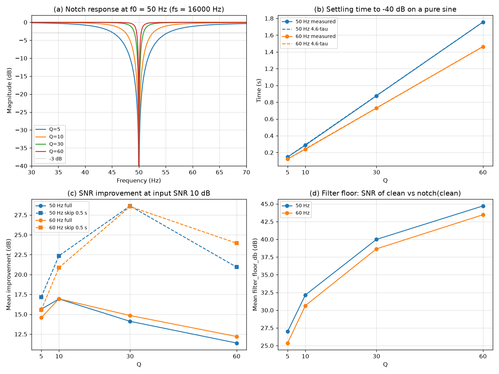

# Speech Hum Removal

This project adds 50 Hz or 60 Hz mains hum to clean speech, detects the hum frequency with an FFT,
and removes it with a second-order IIR notch filter. A Streamlit GUI lets you upload a WAV file,
listen to every stage, look at the plots, and download the filtered audio. Two scripts measure the
results: `evaluate.py` runs a batch evaluation on the dataset, and `q_experiment.py` studies the
effect of the notch quality factor Q.

## Processing pipeline

1. **Load WAV**: the file is mixed to mono, the DC offset is removed, and the native sample rate is kept.
2. **Add hum**: a single 50 Hz or 60 Hz sinusoid is scaled so that the mix has the target SNR.
3. **FFT**: magnitude spectrum (dB) of the noisy signal with a Hann window.
4. **Detect hum frequency**: in the 40–70 Hz band, the strongest bin within ±2 Hz of 50 Hz and of 60 Hz
   is found (parabolic interpolation). The higher one is selected if it is at least 10 dB above the band
   median. Otherwise the frequency chosen in the sidebar is used.
5. **Design notch**: second-order IIR notch at the selected frequency (default Q = 30).
6. **Filter**: `scipy.signal.lfilter` with the notch coefficients.
7. **SNR evaluation**: `snr_db(clean, x) = 10·log10( Σ clean² / Σ (clean − x)² )`, before and after
   filtering, on the full signal and again after skipping the first 0.5 s.
8. **Playback / download**: every stage can be played in the browser; the filtered WAV can be downloaded.

## GUI features (`app.py`)

Sidebar: WAV upload, mains frequency (50/60 Hz), hum level (target SNR 0–30 dB), Q (1–100, under
*Advanced*), and the buttons **Add hum**, **Detect hum**, **Apply notch** and **Reset**.

1. **Original audio**: sample rate, channels, duration, format, samples, peak, RMS, player, waveform.
2. **Audio with hum**: hum frequency, target SNR, measured SNR, player, waveform and spectrum (0–200 Hz),
   clean vs noisy.
3. **Hum detection**: measured peak frequency, prominence, selected mains frequency, detection plot.
4. **Filtered audio**: notch frequency, Q and the coefficients `b`, `a`; player; frequency response
   (magnitude and phase); pole-zero plot with a zoom on the zero/pole pair; spectrum, spectrogram and
   waveform, noisy vs filtered.
5. **Results**: SNR before, SNR after and improvement for the full signal and after skipping the first
   0.5 s; **Download filtered WAV**.

## Notch filter design (`src/notch_filter.py`)

```
w0   = 2·π·f0 / fs          notch frequency (rad/sample)
BW   = w0 / Q               -3 dB bandwidth (rad/sample)
beta = tan(BW / 2)
g    = 1 / (1 + beta)

b = g · [1, −2·cos(w0), 1]
a = [1, −2·g·cos(w0), 2·g − 1]
```

- The default is **Q = 30**, which gives a −3 dB bandwidth of f0/Q (1.67 Hz at 50 Hz, 2.00 Hz at 60 Hz).
- The zeros lie on the unit circle at ±w0, and the poles lie just inside it. `apply_notch` rejects
  unstable coefficients.
- The coefficients match `scipy.signal.iirnotch` (absolute tolerance 1e-10). `iirnotch` is used only as
  a reference in `tests/test_notch_filter.py`, not by the project code.

## Results

All numbers come from `results/evaluation.csv` and `results/q_experiment.csv`.

- **Setup:** 20 files, seed 0, 16 kHz, Q = 30, single-tone hum.
- **Runs:** 120 experiments (20 files × 2 frequencies × 3 SNRs), 0 errors.

### Detection accuracy

| f0 | Correct |
|---|---|
| 50 Hz | 60/60 (100.0%) |
| 60 Hz | 60/60 (100.0%) |

### SNR improvement (dB), Q = 30

Means are computed over the 20 files; all values are rounded to 2 decimals.

| f0 | Input SNR | Full: mean | Full: min | Full: max | Skip 0.5 s: mean | Skip 0.5 s: min | Skip 0.5 s: max |
|---|---|---|---|---|---|---|---|
| 50 Hz | 0 dB | 14.47 | 11.12 | 16.62 | 33.70 | 21.03 | 38.02 |
| 50 Hz | 10 dB | 14.11 | 10.03 | 16.61 | 28.64 | 11.15 | 34.17 |
| 50 Hz | 20 dB | 12.65 | 1.85 | 16.33 | 19.99 | 1.16 | 25.79 |
| 60 Hz | 0 dB | 15.25 | 11.89 | 17.42 | 36.57 | 20.85 | 40.96 |
| 60 Hz | 10 dB | 14.84 | 10.12 | 17.33 | 28.56 | 10.88 | 33.52 |
| 60 Hz | 20 dB | 13.03 | 1.63 | 16.59 | 18.85 | 0.88 | 23.90 |

**Full signal vs skipping 0.5 s.** The poles of the notch are very close to the unit circle, so when the
hum starts the filter needs time to build up its cancellation. During this start-up transient the hum
passes through almost unattenuated. With Q = 30 the measured settling time is 0.876 s at 50 Hz and
0.730 s at 60 Hz (see the Q table). The full-signal value includes the transient, and is the main
result. The second value leaves out the first 0.5 s and shows how well the filter works once it has
(mostly) settled.

**Filter floor.** The notch also removes the speech's own energy near f0. The best SNR-after that is
possible for a file is `filter_floor_db = snr_db(clean, notch(clean))`. Two files have a low floor:

| File | Floor at 50 Hz | Floor at 60 Hz |
|---|---|---|
| arctic_b0466.wav | 22.11 dB | 21.83 dB |
| arctic_b0091.wav | 27.06 dB | 28.39 dB |

`arctic_b0466.wav` gives every minimum in the 10 dB and 20 dB rows above. At 20 dB input SNR its SNR
after filtering is 21.85 dB (50 Hz) and 21.63 dB (60 Hz), which is very close to its floor. This
leaves an improvement of only 1.85 dB and 1.63 dB. Low improvement at high input SNR is therefore
expected when the SNR before filtering approaches the filter floor.

### Effect of Q (`results/q_experiment.csv`, input SNR 10 dB, 20 files)

| Q | f0 | BW measured (Hz) | f0/Q (Hz) | Settling (s) | 4.6·tau (s) | Improvement, full (mean dB) | Improvement, skip 0.5 s (mean dB) | Floor (mean dB) |
|---|---|---|---|---|---|---|---|---|
| 5 | 50 | 10.00 | 10.00 | 0.146 | 0.146 | 15.64 | 17.17 | 26.98 |
| 10 | 50 | 5.00 | 5.00 | 0.287 | 0.293 | 16.93 | 22.37 | 32.14 |
| 30 | 50 | 1.67 | 1.67 | 0.876 | 0.879 | 14.11 | 28.64 | 39.98 |
| 60 | 50 | 0.83 | 0.83 | 1.756 | 1.757 | 11.38 | 20.93 | 44.71 |
| 5 | 60 | 12.00 | 12.00 | 0.122 | 0.122 | 14.57 | 15.53 | 25.36 |
| 10 | 60 | 6.00 | 6.00 | 0.239 | 0.244 | 16.95 | 20.87 | 30.64 |
| 30 | 60 | 2.00 | 2.00 | 0.730 | 0.732 | 14.84 | 28.56 | 38.65 |
| 60 | 60 | 1.00 | 1.00 | 1.463 | 1.464 | 12.20 | 23.94 | 43.46 |

- **Settling time** is the first time after which the output for a unit sine at f0 stays below 0.01
  (−40 dB). The theory is `tau = 1/(π·BW)`, and −40 dB is reached after 4.6·tau.
- **Trade-off:** a higher Q gives a narrower notch, so less speech near f0 is removed and the floor
  rises. But the filter settles more slowly, so more of the start of the hum gets through.
  - Q = 5–10 settles fast but cuts a wide band of speech.
  - Q = 60 keeps the most speech, but needs 1.463–1.756 s to settle.
- **Why Q = 30 is the default:** it gives the highest mean improvement after the start-up transient
  (28.64 dB at 50 Hz, 28.56 dB at 60 Hz). It also keeps a high floor (38.65–39.98 dB) and settles
  in under 0.9 s. Q = 10 gives the best full-signal mean (16.93 / 16.95 dB) because it settles
  faster, but it cuts more speech near f0 (floor 32.14 / 30.64 dB).



## Setup (Windows, PowerShell)

```powershell
python -m venv .venv
.venv\Scripts\Activate.ps1
pip install -r requirements.txt
```

Tested with Python 3.12.10 and the exact package versions pinned in `requirements.txt`
(numpy, scipy, matplotlib, soundfile, streamlit 1.22.0, pandas, pytest).

## How to run

```powershell
streamlit run app.py                 # GUI
python evaluate.py --n-files 20      # batch evaluation -> results/evaluation.csv
python q_experiment.py               # Q study -> results/q_experiment.csv and .png
python -m pytest tests -q            # tests
```

`evaluate.py` options:

| Option | Default | Meaning |
|---|---|---|
| `--data-dir` | `data/wav` | folder with .wav files |
| `--n-files` | 20 | number of files (picked reproducibly) |
| `--seed` | 0 | seed for the file selection |
| `--q` | 30 | notch quality factor |
| `--snr` | `0,10,20` | target SNRs in dB |
| `--f0` | `50,60` | hum frequencies in Hz |
| `--out` | `results/evaluation.csv` | output CSV |

`q_experiment.py` options:

| Option | Default | Meaning |
|---|---|---|
| `--q` | `5,10,30,60` | Q values |
| `--f0` | `50,60` | hum frequencies in Hz |
| `--snr` | 10 | input SNR in dB |
| `--n-files` | 20 | number of files |
| `--seed` | 0 | same file selection as `evaluate.py` |
| `--data-dir` | `data/wav` | folder with .wav files |
| `--out-dir` | `results` | output folder |

## Project structure

```
app.py               Streamlit GUI (sections 1–5)
evaluate.py          batch evaluation: add hum -> detect -> notch -> SNR, one CSV row per experiment
q_experiment.py      effect of Q on bandwidth, settling time, improvement and filter floor
requirements.txt     pinned package versions
src/
  analysis.py        hum generation, FFT magnitude, mains hum detection
  load_audio.py      audio loading (mono, DC removal, resampling), WAV writing
  app_utils.py       upload decoding and plot helpers for the GUI
  notch_filter.py    notch design, filtering, frequency response, pole-zero plot
  metrics.py         SNR in dB
tests/               pytest tests for the filter, metric, GUI helpers and both scripts
data/wav/            CMU ARCTIC SLT speech (1132 WAV files, 16 kHz)
results/             evaluation.csv, q_experiment.csv, q_experiment.png
```

## Limitations

- **Single-tone hum only.** The hum is a single sinusoid at f0. One notch removes only f0; harmonics
  (100/150 Hz, 120/180 Hz, ...) are out of scope.
- **Start-up transient.** The hum passes through at the start of the signal until the notch settles
  (0.730–0.876 s at Q = 30). This is why the full-signal improvement is lower than the value after
  skipping 0.5 s.
- **Filter floor.** On recordings with speech energy near 50/60 Hz, the notch also removes part of the
  speech. This limits the SNR after filtering (for example `arctic_b0466.wav`, floor 22.11 dB at 50 Hz).
- **Tested data.** Evaluated on CMU ARCTIC SLT. All files in `data/wav` are 16 kHz.
  - **Manual 8 kHz test:** the GUI was also tested by hand with an 8 kHz version of `arctic_a0001.wav`.
    It was resampled with `load_audio(target_sr=8000)` and is kept outside the repo.
  - **Result at 60 Hz, Q = 30:** detection gave 60.00 Hz, and the coefficients matched the 8 kHz / 60 Hz
    reference values. SNR went from 10.00 to 25.98 dB (+15.98 dB on the full signal), and improved by
    +30.45 dB after skipping the first 0.5 s.
  - **Automated tests:** these also cover 8 kHz.

## Dataset and credits

Speech data: **CMU ARCTIC**, speaker SLT. Licence: BSD-style. http://festvox.org/cmu_arctic/

> J. Kominek and A. W. Black, "CMU ARCTIC databases for speech synthesis", CMU-LTI-03-177, 2003.

## Team

- **Student 1: Jana**: dataset, audio loading, hum generation, FFT analysis, hum detection.
- **Student 2: Salma**: notch filter, SNR metric, Streamlit app, evaluation and Q experiment, tests.
